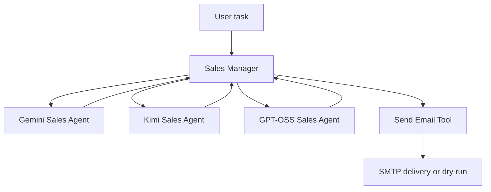

# ComplAI — Multi-Agent Sales Automation System

A Python multi-agent workflow adapted from the ComplAI sales-agent notebook. Three specialist agents create sales-email drafts using different model providers. A Sales Manager coordinates them, compares the drafts, and selects one email for delivery.

## Features
- Gemini, OpenRouter/Kimi, and Groq/GPT-OSS sales-writing agents.
- Sales Manager with the three writers exposed as agent tools.
- Email-sending function tool.
- Pydantic `EmailReview` model and a separate Checker agent.
- Optional output-guardrail example based on the Cowboy agent exercise.
- Environment-variable configuration; no API keys in source code.

## Structure

```text
complai-multi-agent-sales-system/
├── complai/
│   ├── __init__.py
│   ├── config.py
│   ├── models.py
│   ├── sales_agents.py
│   ├── sales_manager.py
│   ├── email_tools.py
│   └── checker.py
├── examples/
│   └── output_guardrail_demo.py
├── app.py
├── messenger.py
├── requirements.txt
├── .env.example
├── .gitignore
└── README.md
```

## Setup

Python 3.10+ is recommended.

1. Create and activate a virtual environment.
2. Install dependencies: `pip install -r requirements.txt`
3. Copy `.env.example` to `.env`.
4. Add your Google, OpenRouter, and Groq API keys to `.env`.

Never commit `.env` or expose API keys.

## Run

```bash
python app.py
```

The manager is instructed to call all three writer tools, compare drafts, and send one selected email. LLM-directed tool selection is not a hard guarantee; inspect outputs and traces during testing.

## Email safety

Email sending is disabled by default. Set `SEND_EMAIL_ENABLED=true` only after configuring and testing SMTP credentials and `SALES_RECIPIENTS`. The tool returns a dry-run message while sending is disabled. Test with an address you control before enabling real delivery.

SMTP accepting a message does not guarantee inbox delivery.

## Checker

The Checker is a separate review capability; the original manager workflow does not automatically run it on every draft.

```python
from complai.checker import review_email
review = await review_email("A draft email to review")
print(review)
```

## Architecture



## Notes
- The manager's comparison is an LLM judgment, not an objective ranking guarantee.
- The output-guardrail demo validates the final output of its Cowboy agent. It does not automatically rewrite rejected content.
- Provider model names may change. Update the `MODEL_*` values in `.env` to models available to your accounts.
